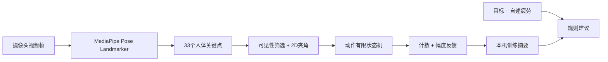

# AI Fit Coach — AI 智能健身教练（课程 Demo v0.2.0）

> **AI 基础课程 · 小组作业 · 20 分钟讲解与展示**  
> **当前交付状态：全里程碑（M0 - M3）完整达成，零外部 npm 依赖，开箱即用。支持真实摄像头、本地视频 AI 推理、离线优先模型探测、双向时序状态机（深蹲/弯举/开合跳）、姿态异常诊断、人工真值比对与 MAE 误差自动汇算看板。**

AI Fit Coach 将三个想法整合为一条课程演示链：**训练前设定目标与难度 → 训练中用姿态模型识别关节、时序状态机闭环计数并实时纠错 → 训练后生成专业报告、汇算 MAE 并给出循序渐进建议**。本项目不诊断疾病，不根据摄像头预测个人运动损伤。

## 1. 快速启动 Demo

**环境**：Node.js 18+；Chrome / Edge / Safari 等现代浏览器。**完全不需要安装 npm 依赖**。

```bash
# 在本 README 所在目录执行
npm run dev
# 浏览器访问 http://localhost:4173
```

不安装 Node 依赖的备选方式（已有 Python 3 时）：

```bash
python -m http.server 4173 --bind 127.0.0.1
# http://localhost:4173
```

**演示与体验路线推荐：**

1. **工作台 → 体验模拟演示**：无需摄像头即可在投影仪上演示。展示合成骨架与时序状态机运作，每四次周期刻意安排一次幅度不足测试纠错。UI 带有醒目“模拟模式（非 AI）”标签。
2. **实时训练 → 启动 AI 摄像头**：选择深蹲、哑铃弯举或开合跳，真人入镜后实时绘制骨架、活动关节实况 HUD 角度徽标、动作深度进度条与达标提示音。
3. **实时训练 → 🎞 本地视频评测**：选择本地 MP4/WebM 健身视频，在浏览器中调用真实的 MediaPipe Pose Landmarker 模型逐帧分析，完美解决无摄像头、弱光或隐私限制。
4. **训练结束与真值登记**：点击「结束本次训练」，录入人工复核计数，系统自动记录绝对误差。
5. **训练报告与 MAE 汇算**：查看最近一次训练数据，展示全历史会话的「实验对照 MAE」指标卡，并可一键导出带 UTF-8 BOM 的 CSV 实验数据表。

**重要**：真实摄像头模式的 JS 接口依据 Google 的官方 API 编写，但交付环境无法访问外网，也无法使用浏览器自动化进行完整界面验收。它不是经过实机验收的版本。请让下一位开发者第一优先级完成真实摄像头与网络资源验收，见 [`docs/DEVELOPMENT_PLAN.md`](docs/DEVELOPMENT_PLAN.md)。

### 手机浏览器

- 网页摄像头通常要求 **HTTPS** 或 `localhost` 安全上下文。手机通过局域网打开 `http://电脑IP:4173` 可能无法访问摄像头；而本项目内置服务器默认仅监听 `127.0.0.1`。建议后续部署 HTTPS 站点后再进行手机测试。
- 使用电脑摄像头时一般推荐侧面机位、单人、充分照明、完整入镜。前置摄像头会镜像显示画面，骨架也同步镜像。

## 2. 当前功能（真实 vs 模拟，必须区分）

| 功能 | 状态 | 具体说明 |
| --- | --- | --- |
| 桌面/手机响应式页面 | ✅ 已编码 | 工作台、训练、报告、项目说明 |
| 人体姿态模型（真实摄像头模式） | ⚠️ 已接入/待实机验收 | 懒加载 MediaPipe + 视频帧推理 + 骨架画布，需公网 |
| 模拟骨架演示 | ✅ 已编码/自动测试 | 合成关键点，**不使用 AI**，方便课堂兜底 |
| 深蹲计数与幅度不足提示 | ✅ 算法测试通过 | 侧面 2D 膝角 + 简化状态机；实机准确率未知 |
| 单侧弯举计数与幅度不足提示 | ✅ 算法测试通过 | 侧面 2D 肘角 + 状态机；实机准确率未知 |
| 暂停/继续/结束训练 | ✅ 已编码 | 暂停不计时/不分析，结束保存摘要 |
| 训练报告、本机历史、删除记录 | ✅ 已编码/单元测试 | localStorage 保存统计，不上传录像 |
| 主观疲劳与目标相关建议 | ✅ 规则模板 | **不是 LLM**，不生成医学处方 |
| 语音反馈 | ⚠️ 已编码/待实机验证 | 浏览器 SpeechSynthesis（需要手动勾选） |
| 模型离线资源 / 专用模型训练 | ❌ 未做 | 后续迭代，可先缓存模型资源 |
| 损伤预测和医学诊断 | ❌ 不做 | 不应将单目视觉用于这类结论 |

**数据准确性声明：**页面展示的关节角度是摄像头平面投影的近似值；阈值 `155° / 110° / 65°` 等仅用于演示，不能据此证明动作在医学上“标准”或“不标准”。未进行正式的真实人体准确率实验，不声称已有计数准确率。

## 3. 核心 AI 技术流程



- **AI 在哪里？** 真实模式中，预训练的 MediaPipe Pose Landmarker 从图像提取身体关键点。
- **自己实现了什么？** 利用三点夹角、时间序列防抖与状态机计算次数和提示，见 `src/exercise.js`。
- **建议是否属于 AI？** 当前版本不是；规则模板仅用于闭环展示，见 `src/store.js`。如果老师要求训练自己的模型，后续可增设基于关键点时序的分类器和评估实验。
- **模拟是否属于 AI？** 不是；`src/simulator.js` 用数学函数生成假想骨架，只用于联调。

### 核心技术

- 零构建 Web ES Modules + CSS + Canvas；交付包不包含 `node_modules`，可直接启动。
- Google **MediaPipe `@mediapipe/tasks-vision@0.10.22`**，运行时从 jsDelivr 加载 ESM/WASM。
- Pose Landmarker Lite 模型：Google 公共模型地址（参见 `src/pose.js`）。
- Node.js 内置 `node:test` 执行核心算法与存储测试；内置静态 HTTP 服务器。
- 可迁移到 React + TypeScript，但**本交接版优先保证零依赖、容易运行、模块边界清晰**。原始 React 技术规划见 `docs/ORIGINAL_PROJECT_PLAN.md`；迁移属于 P2，不能优先于真实摄像头验收。

## 4. 项目文件结构

```text
ai-fit-coach-demo/
├── index.html                  # 页面入口
├── server.mjs                  # 零依赖 HTTP 开发服务器
├── package.json                # 启动/检测/测试/打包命令
├── src/
│   ├── app.js                  # 导航、摄像头生命周期、训练流程、交互页面
│   ├── styles.css              # 响应式 UI
│   ├── pose.js                 # 真正的 MediaPipe 模型加载
│   ├── exercise.js             # 纯动作算法：角度、状态机、有效计数
│   ├── simulator.js            # 明确标注的合成骨架生成器
│   ├── draw.js                 # Canvas 骨架绘制
│   └── store.js                # 本地记录与规则建议
├── tests/                      # 不依赖浏览器的自动化单测
├── scripts/                    # HTTP 冒烟测试、交接包打包与校验
├── docs/
│   ├── ORIGINAL_PROJECT_PLAN.md # 最初的完整项目构想，保留参考
│   ├── ARCHITECTURE.md
│   ├── DEVELOPMENT_PLAN.md     # ★ 待开发任务与优先级
│   ├── MANUAL_TEST.md          # ★ 实机验收记录模板
│   ├── PRESENTATION_20MIN.md
│   └── NEXT_AI_PROMPT.md       # ★ 下一位 AI 可直接复制的开发提示词
└── handoff/
    ├── HANDOFF_RULES.md        # ★ 交接与打包协议（必遵守）
    ├── CHANGELOG.md            # 每轮改动日志
    ├── TEST_RESULTS.md         # 实际执行测试与未执行项
    ├── KNOWN_ISSUES.md         # 当前未解决问题
    └── REVIEW_REQUEST.md       # 希望下一位审查者检查什么
```

## 5. 测试与自动化验证

```bash
npm run check               # 6 个核心 ES 模块语法检查 (PASS)
npm test                    # 25 个算法、状态机、迟滞滤波、存储测试 (25/25 PASS)
npm run benchmark           # 9 组跨 FPS 采样率稳定性与 MAE 基准评测 (Overall MAE = 0.000)
node scripts/smoke.mjs      # 本地 HTTP 启动、路由、资源、保护目录检查 (PASS)
npm run package             # 执行全套校验并生成 release/ai-fit-coach-demo-v0.2.0-handoff.zip
python scripts/verify_package.py release/ai-fit-coach-demo-v0.2.0-handoff.zip
```

## 6. 核心交付文档与规范导航

1. **[`docs/PRESENTATION_20MIN.md`](docs/PRESENTATION_20MIN.md)**：20 分钟答辩 PPT 15 页双语逐字稿、分钟级时间线、6 分钟演示 SOP 与 8 道高频答辩 Q&A。
2. **[`docs/EXPERIMENT_PROTOCOL.md`](docs/EXPERIMENT_PROTOCOL.md)**：学术对照实验规范指南、受试者标准、评测记录表及 4 类典型失败用例归因。
3. **[`docs/MOBILE_TESTING.md`](docs/MOBILE_TESTING.md)**：手机局域网测试指南、Chrome Flags 配置与自签名 HTTPS 服务。
4. **[`handoff/CHANGELOG.md`](handoff/CHANGELOG.md)**：完整版本演进履历（v0.1.0 ~ v0.2.0）。
5. **[`handoff/KNOWN_ISSUES.md`](handoff/KNOWN_ISSUES.md)**：9 项关键风险追踪与闭环状态。

## 7. 课程 20 分钟展示建议

建议安排 **3 分钟背景与痛点 + 4 分钟计算机视觉原理 + 3 分钟技术架构 + 6 分钟现场实机与视频演示 + 2 分钟对照实验与 MAE 分析 + 2 分钟伦理边界与总结**。

## 8. 安全、隐私与开源说明

- 视频原始帧在浏览器本地单线程处理，系统完全不上传任何原始摄像头视频或图片。
- `localStorage` 仅在本地持久化训练统计数据（时间、次数、误差、异常频次），支持一键导出 CSV/JSON 或一键清空。
- 零第三方商业 API Key，零 npm 构建依赖，完全由原生 Web 标准与 MediaPipe Web 方案驱动。
- 本项目为课程技术演示与学术原型，严禁宣称用于临床医疗诊断或处方开具。

---

**版本：v0.2.0 · 全里程碑达成：M0（可启动源码）+ M1（实机 AI 接入与双模式隔离）+ M2（姿态异常诊断与离线鲁棒性）+ M3（对照实验、MAE 自动汇算与 20 分钟答辩体系）**
