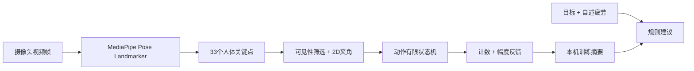

# AI Fit Coach — AI 智能健身教练（课程 Demo v0.1.0）

> **AI 基础课程 · 小组作业 · 20 分钟讲解与展示**  
> **当前交付状态：有完整源码、能启动的网页与可运行的模拟流程；真实摄像头 + MediaPipe 推理已接线，但尚未完成真实设备/在线模型的端到端验收。**

AI Fit Coach 将三个想法整合为一条课程演示链：**训练前设定目标 → 训练中用人体姿态模型识别关节并计数 → 训练后生成报告与一般性训练建议**。本项目不诊断疾病，不根据摄像头预测个人运动损伤。

## 1. 先运行 Demo

**环境**：Node.js 18+；Chrome / Edge 等现代浏览器。**不需要安装 npm 依赖**。

```bash
# 在本 README 所在目录执行
npm run dev
# 浏览器访问 http://localhost:4173
```

不安装 Node 依赖的备选方式（已有 Python 3 时）：

```bash
python -m http.server 4173 --bind 127.0.0.1
# http://localhost:4173
```

**建议按如下顺序试用：**

1. 打开「工作台」，点击「体验模拟演示」：页面立即显示合成骨架，约 5 秒记录一个动作周期；每四次周期刻意安排一次幅度不足。这里**没有运行 AI**，仅用于 UI 与状态机测试。
2. 点击「结束训练」，查看有效次数、幅度未达阈值次数、时间和本机训练报告。
3. 返回「实时训练」，选择「深蹲 / 弯举」，点击「启动 AI 摄像头」。允许摄像头后网页加载 **真实 MediaPipe Pose Landmarker**，首次运行需要访问公网的 jsDelivr 及 Google 模型链接。
4. 侧身站到镜头中，按提示完成动作。实时绘制骨架、角度、计数和指定幅度提示。可点击「暂停 / 继续 / 结束训练」。

**重要**：真实摄像头模式的 JS 接口依据 Google 的官方 API 编写，但交付环境无法访问外网，也无法使用浏览器自动化进行完整界面验收。它不是经过实机验收的版本。请让下一位开发者第一优先级完成真实摄像头与网络资源验收，见 [`docs/DEVELOPMENT_PLAN.md`](docs/DEVELOPMENT_PLAN.md)。

### 手机浏览器

- 网页摄像头通常要求 **HTTPS** 或 `localhost` 安全上下文。手机通过局域网打开 `http://电脑IP:4173` 可能无法访问摄像头；而本项目内置服务器默认仅监听 `127.0.0.1`。建议后续部署 HTTPS 站点后再进行手机测试。
- 使用电脑摄像头时一般推荐侧面机位、单人、充分照明、完整入镜。前置摄像头会镜像显示画面，骨架也同步镜像。

## 2. 当前功能（真实 vs 模拟，必须区分）

| 功能 | 状态 | 具体说明 |
| --- | --- | --- |
| 桌面/手机响应式页面 | ✅ 已编码 | 工作台、训练、报告、项目说明 |
| 人体姿态模型（真实摄像头模式） | ⚠️ 已接入/待实机验收 | 懒加载 MediaPipe + 视频帧推理 + 骨架画布，需公网 |
| 模拟骨架演示 | ✅ 已编码/自动测试 | 合成关键点，**不使用 AI**，方便课堂兜底 |
| 深蹲计数与幅度不足提示 | ✅ 算法测试通过 | 侧面 2D 膝角 + 简化状态机；实机准确率未知 |
| 单侧弯举计数与幅度不足提示 | ✅ 算法测试通过 | 侧面 2D 肘角 + 状态机；实机准确率未知 |
| 暂停/继续/结束训练 | ✅ 已编码 | 暂停不计时/不分析，结束保存摘要 |
| 训练报告、本机历史、删除记录 | ✅ 已编码/单元测试 | localStorage 保存统计，不上传录像 |
| 主观疲劳与目标相关建议 | ✅ 规则模板 | **不是 LLM**，不生成医学处方 |
| 语音反馈 | ⚠️ 已编码/待实机验证 | 浏览器 SpeechSynthesis（需要手动勾选） |
| 模型离线资源 / 专用模型训练 | ❌ 未做 | 后续迭代，可先缓存模型资源 |
| 损伤预测和医学诊断 | ❌ 不做 | 不应将单目视觉用于这类结论 |

**数据准确性声明：**页面展示的关节角度是摄像头平面投影的近似值；阈值 `155° / 110° / 65°` 等仅用于演示，不能据此证明动作在医学上“标准”或“不标准”。未进行正式的真实人体准确率实验，不声称已有计数准确率。

## 3. 核心 AI 技术流程



- **AI 在哪里？** 真实模式中，预训练的 MediaPipe Pose Landmarker 从图像提取身体关键点。
- **自己实现了什么？** 利用三点夹角、时间序列防抖与状态机计算次数和提示，见 `src/exercise.js`。
- **建议是否属于 AI？** 当前版本不是；规则模板仅用于闭环展示，见 `src/store.js`。如果老师要求训练自己的模型，后续可增设基于关键点时序的分类器和评估实验。
- **模拟是否属于 AI？** 不是；`src/simulator.js` 用数学函数生成假想骨架，只用于联调。

### 核心技术

- 零构建 Web ES Modules + CSS + Canvas；交付包不包含 `node_modules`，可直接启动。
- Google **MediaPipe `@mediapipe/tasks-vision@0.10.22`**，运行时从 jsDelivr 加载 ESM/WASM。
- Pose Landmarker Lite 模型：Google 公共模型地址（参见 `src/pose.js`）。
- Node.js 内置 `node:test` 执行核心算法与存储测试；内置静态 HTTP 服务器。
- 可迁移到 React + TypeScript，但**本交接版优先保证零依赖、容易运行、模块边界清晰**。原始 React 技术规划见 `docs/ORIGINAL_PROJECT_PLAN.md`；迁移属于 P2，不能优先于真实摄像头验收。

## 4. 项目文件结构

```text
ai-fit-coach-demo/
├── index.html                  # 页面入口
├── server.mjs                  # 零依赖 HTTP 开发服务器
├── package.json                # 启动/检测/测试/打包命令
├── src/
│   ├── app.js                  # 导航、摄像头生命周期、训练流程、交互页面
│   ├── styles.css              # 响应式 UI
│   ├── pose.js                 # 真正的 MediaPipe 模型加载
│   ├── exercise.js             # 纯动作算法：角度、状态机、有效计数
│   ├── simulator.js            # 明确标注的合成骨架生成器
│   ├── draw.js                 # Canvas 骨架绘制
│   └── store.js                # 本地记录与规则建议
├── tests/                      # 不依赖浏览器的自动化单测
├── scripts/                    # HTTP 冒烟测试、交接包打包与校验
├── docs/
│   ├── ORIGINAL_PROJECT_PLAN.md # 最初的完整项目构想，保留参考
│   ├── ARCHITECTURE.md
│   ├── DEVELOPMENT_PLAN.md     # ★ 待开发任务与优先级
│   ├── MANUAL_TEST.md          # ★ 实机验收记录模板
│   ├── PRESENTATION_20MIN.md
│   └── NEXT_AI_PROMPT.md       # ★ 下一位 AI 可直接复制的开发提示词
└── handoff/
    ├── HANDOFF_RULES.md        # ★ 交接与打包协议（必遵守）
    ├── CHANGELOG.md            # 每轮改动日志
    ├── TEST_RESULTS.md         # 实际执行测试与未执行项
    ├── KNOWN_ISSUES.md         # 当前未解决问题
    └── REVIEW_REQUEST.md       # 希望下一位审查者检查什么
```

## 5. 测试和打包

```bash
npm run check               # JavaScript 语法检查
npm test                    # 16 个纯算法/存储测试（具体结果以当次输出为准）
node scripts/smoke.mjs      # 本地 HTTP 启动、路由、资源、保护目录检查
npm run package             # 生成 release/ai-fit-coach-demo-v0.1.0-handoff.zip
python scripts/verify_package.py release/ai-fit-coach-demo-v0.1.0-handoff.zip
```

> 上面不包含“真实摄像头识别准确率”和“浏览器 UI E2E”的证明。交付方必须诚实披露这两类是否验证。

## 6. 下一位 AI 应先阅读什么？

1. **[`handoff/HANDOFF_RULES.md`](handoff/HANDOFF_RULES.md)**：统一开发、测试、命名、打包、交付和验收规范。
2. **[`docs/DEVELOPMENT_PLAN.md`](docs/DEVELOPMENT_PLAN.md)**：每阶段要完成的具体任务、依赖、验收标准和禁止扩范围。
3. **[`docs/NEXT_AI_PROMPT.md`](docs/NEXT_AI_PROMPT.md)**：可直接复制给 AI 的工作指令。
4. **[`handoff/KNOWN_ISSUES.md`](handoff/KNOWN_ISSUES.md)**：现有 bug / 未验证风险。
5. **[`docs/MANUAL_TEST.md`](docs/MANUAL_TEST.md)**：真实设备测试顺序与结果模板。

**下一位 AI 每轮只做一个明确里程碑**，保持现有可运行链路，修复测试失败后更新所有交接材料，并通过 `npm run package` 输出完整源码包。将 zip 交给审查者后，不应以一句“做完了”代替测试和证据。

## 7. 课程 20 分钟展示

详见 [`docs/PRESENTATION_20MIN.md`](docs/PRESENTATION_20MIN.md)。建议安排 **3 分钟背景 + 4 分钟 AI 原理 + 3 分钟架构 + 6 分钟实机演示 + 2 分钟实验与局限 + 2 分钟总结**。实验指标必须来自真实测试记录，不得引用模拟模式的计数来声称模型准确率。

## 8. 安全、隐私与来源

- 视频原始帧在浏览器本地处理，应用代码不上传原始摄像头图像；但首次加载模型和 JS/WASM 会向第三方资源服务发请求，MediaPipe 运行库还可能产生其文档说明的使用情况指标，实际部署需按政策披露与取得适当同意。
- `localStorage` 仅保存每次训练的时间、次数、动作类型、模式和反馈配置；用户可以清空记录。
- 不依赖智能手表、后台服务或大语言模型 API；不要在前端添加任何 API 私钥。
- 本项目是课程技术演示，不是医疗建议、康复处方或运动风险评分工具。出现疼痛/眩晕/不适应停止训练。
- 开源第三方： [MediaPipe 官方 Web 文档](https://developers.google.com/edge/mediapipe/solutions/vision/pose_landmarker/web_js) 与 [MediaPipe GitHub](https://github.com/google-ai-edge/mediapipe)。模型和运行库的第三方许可应在下次正式发布前核验。

---

**版本：v0.1.0 · 里程碑：M0（可启动源码 + 模拟闭环 + 真人推理接线） · 下一里程碑：M1（实机 AI 验收与故障修复）**
