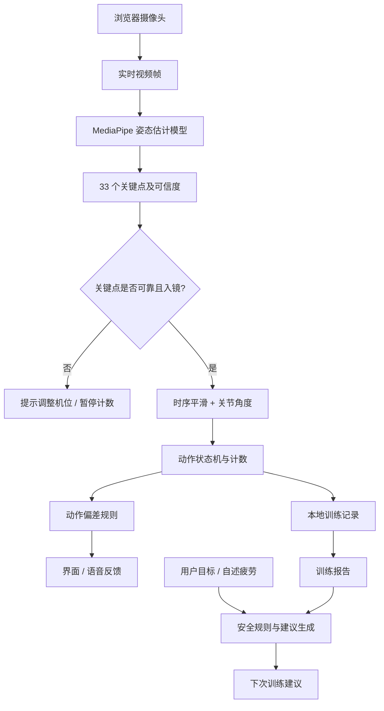

# AI Fit Coach｜基于人体姿态识别的智能健身教练

> **AI 基础课程小组项目 · 项目规划版 README**  
> 项目状态：**规划中 / 待开发**（本文描述目标设计，不代表功能已经实现）  
> 交付目标：**一个能在浏览器运行的网页 Demo + 测试结果 + 20 分钟课堂讲解与演示**

## 1. 项目简介

**AI Fit Coach** 是一个仅使用普通电脑摄像头或手机摄像头的 AI 健身辅助系统。用户在网页中选择动作并开始训练，系统利用预训练人体姿态估计模型提取关键点，再通过关节角度和动作状态机完成**动作计数、指定错误提示、训练记录**；训练结束后，结合用户目标及主观疲劳情况提供**基础训练建议**。

本项目融合三个原始创意：

1. **随身 AI 健身教练**：实时动作识别、计数与纠错；
2. **运动损伤风险预测与恢复建议**：改造为动作风险因素提示、运动限制问卷和训练后恢复提醒，**不进行疾病诊断或个体受伤概率预测**；
3. **个性化器械健身助手**：根据目标、经验和可用器械给出训练安排与使用说明，第一版不识别具体器械型号。

### 项目目标

- **看得见 AI**：实时绘制人体关键点和骨架连线；
- **用得上 AI**：支持深蹲计数、基础动作纠错；在时间允许时增加哑铃弯举；
- **讲得清 AI**：区分“预训练姿态估计模型”“自编写的运动规则”“可选的大语言模型建议”；
- **测得出结果**：以人工计数与标注为参照，对识别计数、误报和性能进行实验；
- **展示得完整**：训练前选择目标 → 训练中获取反馈 → 训练后查看报告与建议。

## 2. 适用场景与边界

- **使用设备**：笔记本电脑摄像头、USB 摄像头、带摄像头的手机浏览器；不依赖智能手表。
- **首选交付形式**：Web 网页；Android 原生应用属于未来扩展，不是本次课程作业的必要部分。
- **拍摄条件**：单人、相对固定的机位、光线充足、人体和主要关节尽量完整入镜。
- **训练场景**：课内技术演示、低风险的基础健身动作指导，**不是**专业教练或医疗服务的替代品。
- **主要限制**：普通单摄像头无法可靠测量关节真实受力、器械阻力、内部损伤或未来受伤概率。模型估计的世界坐标不等于专业三维动作捕捉数据。

## 3. 功能范围与优先级

| 级别 | 功能 | 预期效果 | 验收方式 |
| --- | --- | --- | --- |
| **P0 必做** | 摄像头接入 | 请求用户授权，实时预览画面 | 能启动、暂停、关闭摄像头 |
| **P0 必做** | 人体姿态识别 | 显示骨架与主要关键点 | 正常站立及动作中可持续显示 |
| **P0 必做** | 深蹲计数 | 根据动作周期统计有效次数 | 与人工计数比较 |
| **P0 必做** | 基础动作提示 | 对幅度不足、未入镜等情况提示 | 设计测试动作复现 |
| **P0 必做** | 训练报告 | 展示次数、耗时、提示记录 | 训练结束自动生成 |
| **P1 建议** | 哑铃弯举计数 | 支持第二个动作，证明可扩展性 | 与人工计数比较 |
| **P1 建议** | 语音播报 | 语音读出次数或纠错提示 | 实机播放、无连续刷屏 |
| **P1 建议** | 个性化建议 | 根据目标、疲劳和训练数据给出建议 | 不同输入得到合理不同的输出 |
| **P1 建议** | 历史训练记录 | 保存本机最近训练数据 | 刷新后可查看已保存记录 |
| **P2 选做** | 运动状态问卷 | 自述疼痛、疲劳或限制，生成安全提醒 | 不输出医学诊断 |
| **P2 选做** | 器械使用指导 | 手动选择器械并展示基本动作要点 | 展示至少一种器械说明 |
| **暂不做** | 自研大型姿态模型、医学损伤预测、自动识别哑铃重量、多设备同步、复杂社交功能 | 避免超出课程作业范围 | — |

> **保底交付原则**：若时间紧张，优先保证“摄像头 → 骨架 → 深蹲计数 → 一项纠错提示 → 报告”这一条链路真实可运行。其余功能按优先级逐步增加。

## 4. 用户流程

1. **训练前**：打开网页，授权摄像头，选择深蹲或弯举；可填写健身目标与经验。
2. **机位校准**：根据提示调整手机/电脑位置，使相关关节清晰可见。深蹲计数第一版优先支持**侧面拍摄**。
3. **训练中**：网页实时显示骨架、动作状态、累计次数和必要提示；质量不足时暂停判断。
4. **训练后**：展示训练时长、有效次数、幅度不足次数和提示摘要；用户输入主观用力程度或疲劳情况。
5. **训练建议**：通过安全约束的规则模板生成简单的下次训练建议；如接入大语言模型，仅由其组织文字，不允许绕过规则。

## 5. 技术选型

| 层次 | 推荐技术 | 作用 | 是否必要 |
| --- | --- | --- | --- |
| 界面 | React + TypeScript + Vite | 页面、交互、开发构建 | 必要 |
| 摄像头 | Web API `getUserMedia()` | 获取电脑/手机视频流 | 必要 |
| 姿态模型 | MediaPipe Pose Landmarker（`@mediapipe/tasks-vision`） | 估计 33 个人体姿态关键点 | 必要 |
| 骨架绘制 | Canvas 2D + MediaPipe DrawingUtils | 关键点和骨架叠加 | 必要 |
| 动作分析 | TypeScript + 关节角度 + 状态机 | 计数、动作阶段、提示 | 必要 |
| 语音反馈 | 浏览器 `speechSynthesis` | 播报训练信息 | 建议 |
| 本地存储 | `localStorage`（数据量增大可用 IndexedDB） | 训练记录、偏好设置 | 建议 |
| 文本建议 | 规则模板；大语言模型 API 为选做 | 训练总结、个性化说明 | 可选 |
| 后端 | 首版可不设后端 | 简化交付、减少部署成本 | 非必要 |

**为什么不一开始训练模型？** MediaPipe 已提供成熟的人体关键点模型。对于基础课程，重点是展示“预训练模型输出 → 运动学特征 → 可解释判断 → 用户反馈”的完整应用；如果未来收集到充足、已获同意且标注质量可靠的关键点时序数据，再考虑训练小型动作分类器。

**实现提醒**：

- Web 端摄像头实时分析可使用 `runningMode: "VIDEO"` 配合 `requestAnimationFrame` 和 `detectForVideo(video, timestampMs)`；
- 视频推理可能占用主线程，应按设备性能控制分析频率，必要时探索 Web Worker；
- 优先本地运行姿态识别，避免上传原始摄像头视频；
- 正式部署使用 **HTTPS**，开发时一般可在 **localhost** 测试摄像头访问；
- 大语言模型密钥若使用，必须放在后端/代理服务端，不写入前端源码；
- 固定并记录依赖和模型版本，避免课堂展示时因 CDN 更新而失效。

## 6. 系统架构



### 模块接口约定（拟定）

- **CameraService**：负责权限、开始/结束、视频流状态；
- **PoseEstimator**：输入视频帧，输出时间戳、姿态关键点和置信度；
- **AngleCalculator**：根据三点坐标计算二维夹角；
- **ExerciseAnalyzer**：按动作类型识别阶段、计数与偏差；
- **FeedbackManager**：负责提示优先级、冷却时间、语音合成；
- **SessionStore**：保存训练概要及用户偏好；
- **RecommendationEngine**：根据规则生成训练建议，可扩展 LLM 文案生成。

## 7. 核心算法设计

### 7.1 关节角度

取同一图像平面内的三个关键点 `A`（近端关节）、`B`（待测关节）、`C`（远端关节），计算 `BA` 与 `BC` 两向量的夹角：

\[
\theta=\arccos\left(\frac{(A-B)\cdot(C-B)}{\lVert A-B\rVert\lVert C-B\rVert}\right)
\]

- 深蹲示例：髋部—膝盖—脚踝，得到近似二维膝关节夹角；
- 弯举示例：肩部—肘部—手腕，得到近似二维肘关节夹角；
- 在计算前做关键点置信度检查，并进行简单时序平滑；
- 这些角度是**摄像头视角下的近似值**，不是临床测量结果。

### 7.2 深蹲动作计数（示例规则）

首版采用侧面视角：

1. 站立准备：膝角大于示例阈值 `155°`，进入 `READY`；
2. 开始下蹲：角度持续下降，进入 `DESCENDING`；
3. 达到规定幅度：膝角小于示例阈值 `110°`，进入 `BOTTOM`；
4. 重新站起：角度回升且再次大于 `155°`，**计为一次**；
5. 如果未达到底部阈值就直接站起，提示“本次幅度未达预设要求”，不记有效次数；
6. 在关键点遮挡、多人入镜、角度异常跳变时暂缓判断，避免误计。

> `155° / 110°` 只是**开发初始参数**，不是适用于所有人的标准训练幅度，更不代表受伤风险阈值。实际使用时应根据拍摄角度、个体能力、动作类型和测试结果进行校准，不应用于医疗结论。

### 7.3 哑铃弯举计数（P1）

- 手臂侧向摄像头且肩、肘、腕可见；
- 手臂伸展（例：肘角 > `150°`）→ 完成屈肘（例：肘角 < `65°`）→ 再伸展；
- 完整闭环记一次；单侧先做，双侧同步或交替计数可延后；
- 用户手动输入哑铃重量，摄像头不负责推断重量。

### 7.4 防抖、反馈与安全规则

- **防抖**：对角度做滑动中值/均值滤波，切换状态要求持续若干帧；
- **提示冷却**：同一问题不频繁连播；
- **可解释性**：优先显示“幅度不足”“关节暂时不可见”“请侧身”等可验证信息；
- **不滥用医学推断**：不依据一个动作画面判断骨盆前倾疾病、脊柱侧弯或韧带损伤；
- **主动停止条件**：用户报告疼痛、眩晕或不适时，提示停止训练并在需要时寻求专业帮助。

## 8. 训练建议逻辑

第一版采用**规则模板**即可，不必为生成建议依赖云端模型：

| 输入条件（示例） | 基础建议策略 |
| --- | --- |
| 新手 + 首次训练 | 推荐低强度、短时长、以掌握动作流程为主 |
| 动作幅度不足次数较多 | 保持或降低任务难度，优先练习控制与机位校准 |
| 自述疲劳程度较高 | 不建议立刻增加训练量，提醒休息和恢复 |
| 动作完成稳定 + 自述疲劳较低 | 在预设安全范围内考虑下次小幅增加训练量 |
| 存在疼痛或运动禁忌 | 不进行自动加量；提示停止引起不适的动作，必要时求助专业人士 |

如果后期增加 LLM，其输入应当是**结构化、经过规则校验的训练摘要**，而不是未经处理的摄像头视频；模型仅生成易理解的解释文字。建议结果须标注“供一般健身参考”。

## 9. 拟定项目目录

> 以下为**推荐目录结构**，不是已有文件清单。实际编码时按需要逐步建立。

```text
ai-fit-coach/
├── README.md
├── public/
│   └── models/                  # Pose Landmarker 模型文件（需按许可获取）
├── src/
│   ├── app/                     # 路由、应用入口
│   ├── components/              # 摄像头、骨架画布、状态提示 UI
│   ├── features/
│   │   ├── camera/              # 摄像头权限、视频流管理
│   │   ├── pose/                # MediaPipe 加载、关键点转换
│   │   ├── exercise/            # 角度计算、动作状态机与纠错
│   │   ├── feedback/            # 页面反馈、语音反馈
│   │   ├── session/             # 训练流程和数据存储
│   │   └── recommendation/      # 训练建议规则
│   ├── pages/                   # 首页、训练页、报告页
│   ├── types/                   # 类型定义
│   └── utils/                   # 通用工具
├── tests/                       # 算法单元测试、测试样例
└── docs/
    ├── experiment.md            # 实验设计与结果（待完成）
    └── presentation.md          # 20 分钟演示讲稿（待完成）
```

## 10. 环境准备与项目启动（待创建）

**环境**：Node.js（符合当前 Vite 版本要求）、npm、支持摄像头的 Chrome/Edge 等现代浏览器。

本仓库目前仍处于需求规划阶段，**下面是从零搭建前端的推荐命令，并不表示当前已有可以直接运行的源码**：

```bash
# 1. 创建 React + TypeScript 项目
npm create vite@latest ai-fit-coach -- --template react-ts

# 2. 安装依赖
cd ai-fit-coach
npm install
npm install @mediapipe/tasks-vision

# 3. 启动本地开发服务器
npm run dev
```

接入姿态识别时，需依据官方文档配置 **WASM 资源**和 **Pose Landmarker `.task` 模型文件**；模型路径、文件名与实际下载版本保持一致。录制/部署前在**断网或网络波动场景**测试资源加载策略，避免课堂 Demo 依赖临时 CDN。

### 摄像头权限提醒

- 开发环境访问 `http://localhost:端口` 通常可使用摄像头；
- 手机访问部署站点时应使用 HTTPS，并在浏览器中授予摄像头权限；
- 前置摄像头可优先请求 `facingMode: "user"`，但用户也可能需要切换后置摄像头；
- 画面若做镜像显示，坐标判定必须与实际关键点数据保持一致；
- 未授予权限时应显示友好提示，而不是让页面报错或卡住。

## 11. 测试方案与验收标准

课堂项目需要**真实测试数据**，不能把预期准确率当成已测结果。

### 实验设计（建议）

- 邀请至少 **3 名**知情同意的组员/志愿者；
- 每人测试 **2 种动作 × 2 种光照或距离条件 × 每种 10 次**，共约 `3 × 2 × 2 × 10 = 120` 次人工标注动作；
- 加测幅度不足、部分关节遮挡、侧身角度偏差等案例；
- 由人工逐条记录动作是否完成及有效次数，再与系统结果比较；
- 同时记录设备型号、浏览器、平均处理帧率、失败原因。

### 评价指标

| 指标 | 计算方式/意义 | 第一阶段建议验收目标 |
| --- | --- | --- |
| 计数绝对误差（MAE） | `平均值(|系统次数 − 人工次数|)`，按每段视频/每组统计 | 正常机位下每组 10 次平均误差 ≤ 1 次 |
| 动作阶段识别 | 对照人工标注的完整/未完整动作 | 能正确区分典型成功与幅度不足案例 |
| 实时性能 | 设备端可持续分析的帧率、响应感受 | 在演示设备上视觉反馈连续、无明显积压 |
| 稳定性 | 遮挡、失去追踪、拒绝授权时的行为 | 可恢复，不错误累积大量计数 |
| 可解释性 | 提示能否对应实际检测到的问题 | 提示规则与演示行为一致 |

以上是**目标，不是已达到的成绩**。正式报告应给出测量数据、测试条件、失败案例和局限性。

### 最小可交付定义（Definition of Done）

- [ ] 网页可请求并停止摄像头；
- [ ] 模型能加载并在视频上绘制骨架；
- [ ] 深蹲完整动作可自动计数；
- [ ] 至少一种可复现的异常场景能给出正确提示；
- [ ] 训练结束可查看有效次数、训练耗时和提示摘要；
- [ ] 有真实的人工对照测试结果；
- [ ] 有无需网络依赖的备用演示视频；
- [ ] PPT 能解释“模型、规则、评价指标、局限性”。

## 12. 开发路线与小组协作

以课程作业为目标，采用**里程碑而不是堆功能**的方式推进：

| 阶段 | 工作重点 | 可展示成果 |
| --- | --- | --- |
| M1：基础打通 | 创建网页、申请摄像头权限、加载模型、绘制骨架 | 实时人体关键点演示 |
| M2：核心闭环 | 实现深蹲角度、动作状态机、计数、纠错 | 现场做动作，系统实时反馈 |
| M3：完整体验 | 报告、训练目标、规则建议；有余力再加弯举 | 从训练到报告的一条完整链路 |
| M4：实验与答辩 | 测试、修复问题、录屏、准备 PPT 和讲稿 | 可复现结果、20 分钟演示 |

**四人分工示例**（可按实际人数合并/调整）：

| 角色 | 核心职责 |
| --- | --- |
| AI 模型负责人 | 模型选型、MediaPipe 接入、关键点质量控制 |
| 算法负责人 | 角度计算、动作阶段、计数、提示规则、单元测试 |
| 前端负责人 | UI、视频叠加、训练流程、报告、数据存储 |
| 实验与展示负责人 | 测试设计与记录、系统集成、演示视频、PPT |

建议所有成员都能说清楚：为什么选择现成姿态模型、规则算法如何工作、测试结果有哪些不足。

## 13. 20 分钟课堂讲解与展示

| 环节 | 时长 | 内容 |
| --- | --- | --- |
| 背景与需求整合 | 2 分钟 | 三个创意为何能融合；最终项目解决什么问题 |
| 核心 AI 原理 | 4 分钟 | 姿态关键点、模型输入输出、关节角度、状态机 |
| 系统设计 | 3 分钟 | 页面、数据流、模块职责、为什么不从零训练模型 |
| **现场演示** | **6 分钟** | 摄像头 → 骨架 → 深蹲计数 → 纠错 → 训练报告 |
| 测试与局限 | 3 分钟 | 真实实验、误差、机位/遮挡、非医学诊断边界 |
| 总结与展望 | 2 分钟 | 创新点、扩展方向、团队收获 |
| **合计** | **20 分钟** |  |

### 建议演示脚本

1. 打开网页并展示实时骨架；
2. 组员完成约 5 次深蹲，展示计数；
3. 有意做一次幅度不足的动作，展示提示（演示前验证该用例）；
4. 结束训练，展示报告；
5. 修改用户训练目标或疲劳反馈，展示建议变化；
6. 如果已实现 P1，快速切换弯举模式。

**务必准备真实运行录屏**（不是模拟动画）作为备用，现场同时保留手动刷新、切换摄像头和重新初始化模型的操作入口。

## 14. 预期亮点与创新性

1. **一个视觉模型服务三个健身需求**：训练前、训练中、训练后共享同一套训练数据；
2. **可解释的动作反馈**：不仅展示骨架，还显示角度、动作阶段和错误原因；
3. **形成反馈闭环**：识别动作 → 生成训练报告 → 根据训练表现调整建议；
4. **轻量部署、低硬件门槛**：只需要普通摄像头和浏览器；
5. **有验证过程**：通过人工标注对照实验评估效果，而不只展示页面。

> 我们的创新重点不是声称训练出更先进的人体视觉大模型，而是将现成 AI 感知能力与具体运动任务、可解释规则和训练反馈整合成可演示、可评估的系统。

## 15. 已知风险、隐私与免责声明

- **视觉局限**：遮挡、侧身角度、服装、弱光、机位距离会影响关键点质量；错误判断应有“不确定”状态。
- **个体差异**：动作阈值是演示用经验参数，不能直接作为针对所有人的训练标准；
- **安全边界**：仅提供一般健身辅助，不诊断骨骼肌肉疾病、不估算未来损伤概率；出现疼痛或其他不适应停止训练；
- **隐私优先**：默认尽量在浏览器本地完成视频推理；未经明确同意，不上传或保存原始视频；
- **数据最小化**：训练记录只保存必要统计数据，提供清除本地记录的功能；
- **知识产权**：所使用模型、素材、第三方代码和动作示范应保留来源并遵守对应许可证；
- **准确表达**：课堂中明确区分“已实现”“计划实现”“未来扩展”，不可编造测试数据。

## 16. 后续可扩展方向（不纳入首版承诺）

- 扩展更多动作、不同拍摄角度与双侧动作；
- 采集获授权、带标注的骨架时序数据，训练轻量动作分类模型并与规则方法比较；
- 将核心体验移植为 Android 应用；
- 加入更完善的器械库、训练负荷管理、运动恢复提醒；
- 在经过充分专业验证后，探索更可靠的动作风险因素分析。

## 17. 参考资料

1. [Google AI Edge：Pose Landmarker 官方文档](https://ai.google.dev/edge/mediapipe/solutions/vision/pose_landmarker) — 模型能力、Web 接入和示例。
2. [MediaPipe 官方 Web 示例](https://github.com/google-ai-edge/mediapipe-samples) — 可参考的 SDK 使用方式与项目结构。
3. [MDN：MediaDevices.getUserMedia()](https://developer.mozilla.org/en-US/docs/Web/API/MediaDevices/getUserMedia) — 浏览器摄像头权限、HTTPS 等要求。
4. [Vite 官方文档](https://vite.dev/guide/) — Web 项目初始化和开发构建。

---

### 当前进度

- [x] 明确三项需求的融合方向与安全边界
- [x] 确定课程展示导向的 MVP 范围
- [x] 完成项目规划 README
- [ ] 创建前端工程并接入摄像头
- [ ] 加载姿态识别模型并绘制骨架
- [ ] 完成动作状态机与计数
- [ ] 完成训练报告与建议
- [ ] 采集测试结果并完成课堂展示

**课程作业验收口径：能运行、有真正的 AI 推理、流程完整、结论基于测试、局限说明清楚。**
