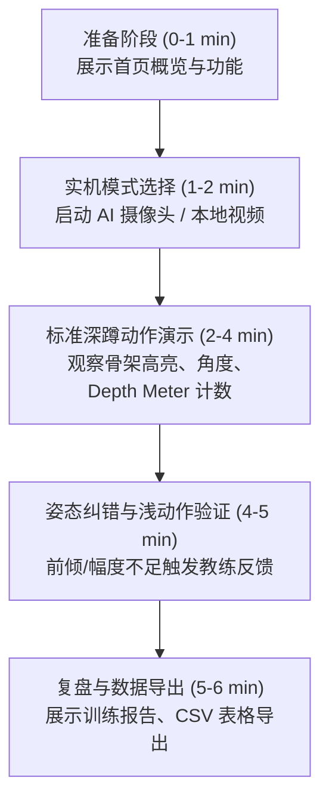

# 20 分钟课堂讲解、实机演示与答辩指南（完整稿）

> **课程设计场景**：AI 视觉健身课设 / 20 分钟公开汇报展示。  
> **核心原则**：学术诚信、明确区分预训练 AI 模型与启发式状态机规则、严格划定非医疗技术边界、数据 100% 留存在浏览器本地。

---

## 一、20 分钟演讲时间线分配

| 时间区间 | 环节 | 对应 PPT | 讲者核心信息与现场动作 |
| :--- | :--- | :--- | :--- |
| **00:00 - 02:30** | 项目背景与核心创意整合 | 第 1–3 页 | 介绍健身痛点：传统手环无姿态信息、私教成本高；阐明“训练前-中-后”一体化闭环。 |
| **02:30 - 06:30** | 核心技术原理与算法架构 | 第 4–8 页 | 阐明 **MediaPipe 33 点姿态估计 + 向量几何夹角计算 + 有限状态机（FSM）** 的分层设计。 |
| **06:30 - 08:30** | 系统架构、离线策略与边界 | 第 9–10 页 | 零构建 ES Modules 架构、本地离线模型优先加载（M2-01）、非医疗安全边界说明。 |
| **08:30 - 14:30** | **实机系统演示（核心 6 分钟）** | 现场操作 | 演示启动 AI 摄像头/本地视频评测/模拟模式；完成深蹲、弯举、开合跳实时跟踪与报告导出。 |
| **14:30 - 17:30** | 对照实验、误差分析与局限 | 第 11–13 页 | 展示人工与系统对照实验（MAE 指标）、机位敏感度分析、错误与遮挡案例复盘。 |
| **17:30 - 20:00** | 组员分工、总结与答辩准备 | 第 14–15 页 | 总结技术沉淀与未来展望，进入评委老师提问环节。 |

---

## 二、PPT 15 页逐页设计与演讲逐字要点

### 第 1 页：封面与团队
- **标题**：基于 Web 端姿态估计的 AI 视觉健身教练演示系统
- **副标题**：MediaPipe 关键点检测 · 几何状态机 · 本地轻量化交互
- **讲者发言**：
  > “各位评委老师、同学们好！今天我们小组汇报的课题是《基于 Web 端姿态估计的 AI 视觉健身教练》。本项目致力于在无需安装任何 App、不依赖高端穿戴设备的前提下，仅凭一台带摄像头的普通电脑或手机浏览器，为大众健身者提供实时的动作计数、幅度反馈与姿态提醒。”

### 第 2 页：痛点分析与三大创意整合
- **痛点**：传统智能手表只能根据加速度计粗略感应，无法感知深蹲是否下潜到位；商业私教成本高；手机健身视频缺乏互动。
- **创意整合**：
  1. **训练前**：自适应机位指引与难度预设（初学/标准/进阶）；
  2. **训练中**：24+ FPS 骨架叠加、实时关节测角、动作深度标尺、语音与音频即时反馈；
  3. **训练后**：本地结构化报告、多维度疲劳建议、一键导出 CSV/JSON 用于可复现实验。

### 第 3 页：技术范围与非目标声明（诚信与安全底线）
- **实现范围**：
  - 深蹲（膝角弯曲）、哑铃弯举（肘角收缩）、开合跳（双臂展角双向扩展）3 种动作；
  - 纯前端零构建部署（Native Web ES Modules + WebAssembly）；
  - 真实 AI 模式与合成模拟器模式严格独立标记。
- **明确非目标（Non-Goals）**：
  - ✘ **不做** 医疗级骨骼畸形或关节病变诊断；
  - ✘ **不做** 云端录像上传（杜绝隐私泄漏）；
  - ✘ **不编造** 无法复现的“99.9% 准确率”。

### 第 4 页：底层 AI 视觉模型：Google MediaPipe Pose
- **模型架构**：BlazePose 轻量级拓扑，采用 Detector + Tracker 双阶段级联管道。
- **输出**：33 个三维规范化人体关键点（$(x, y, z)$ 坐标及可见度 visibility）。
- **选型考量**：
  - 相比在浏览器运行完整大型 ResNet/OpenPose，MediaPipe Lite（仅 9MB）结合 WebAssembly/SIMD 能在 CPU 上稳定跑满 25–30 FPS，满足实时动作反馈的低时延需求。

### 第 5 页：核心算法一：几何夹角与 EMA 平滑滤波
- **关节夹角计算公式**：
  给定关键点 $A(x_1, y_1)$、$B(x_2, y_2)$（顶点）、$C(x_3, y_3)$：
  $$\vec{BA} = (x_1 - x_2, y_1 - y_2), \quad \vec{BC} = (x_3 - x_2, y_3 - y_2)$$
  $$\theta = \arccos\left(\frac{\vec{BA} \cdot \vec{BC}}{\|\vec{BA}\| \|\vec{BC}\|}\right) \times \frac{180^\circ}{\pi}$$
- **抖动抑制（EMA 滤波）**：
  $$\theta_{\text{smooth}}^{(t)} = 0.55 \times \theta_{\text{smooth}}^{(t-1)} + 0.45 \times \theta_{\text{raw}}^{(t)}$$
  有效平滑了单目视觉噪点，避免微小抖动引发误计数。

### 第 6 页：核心算法二：有限状态机（Finite State Machine）
- **状态流转设计**：
  `等待站稳` $\to$ `已就绪`（角度达到起始基准） $\to$ `动作进行中`（跨越触发阈值） $\to$ `完成幅度 · 返回起点` $\to$ 满足时长/极值后 `计数 +1` 并回归 `已就绪`。
- **双向扩展支持**：
  - **屈曲收缩型（深蹲/弯举）**：由大变小（$155^\circ \to \le 110^\circ \to 155^\circ$）；
  - **舒展展开型（开合跳）**：由小变大（$35^\circ \to \ge 130^\circ \to 35^\circ$）。
- **异常保护**：动作时长 $< 650\text{ms}$（过快防抖）或两帧间隔 $> 1200\text{ms}$（切后台/丢帧）自动作废未完成动作。

### 第 7 页：核心算法三：肢体侧别自适应与迟滞（Hysteresis）锁定
- **问题**：侧身深蹲时，若两腿重叠，左右腿可见度微小抖动会导致测量关节在左右腿之间快速跳变。
- **迟滞方案**：引入 `hysteresis = 0.12` 置信度门限。除非另一侧肢体置信度超越当前侧 0.12 以上，否则保持当前侧；一旦动作进入进行中（`inRep`），全程刚性锁定侧别。

### 第 8 页：生物力学姿态风险检测（Posture Fault Detection）
- **深蹲躯干过度前倾（Trunk Lean）**：
  侧面计算肩-髋向量与垂直垂线夹角，若深蹲下潜时躯干倾角 $> 46^\circ$，提示挺胸收腹，降低腰椎代偿风险。
- **弯举手肘借力摆动（Arm Swing）**：
  检测肘关节相对于肩关节的横向位移，偏移超过基准值时提示贴紧肋侧，避免背部借力。
- **开合跳双侧不对称（Arm Asymmetry）**：
  对比左臂与右臂展开角度，差值 $> 35^\circ$ 时提示双侧同步起落。
- **冷却防抖**：同类错误警报间隔 $\ge 3000\text{ms}$，杜绝语音刷屏。

### 第 9 页：系统架构与零构建纯前端设计
- **文件规范**：原生 ES Modules（`src/app.js`, `src/exercise.js`, `src/pose.js`, `src/simulator.js`, `src/store.js`, `src/draw.js`）。
- **离线模型加载策略（M2-01）**：
  - 启动时自动通过 HTTP `HEAD` 探测本地 `/models/pose_landmarker_lite.task`；
  - 本地存在时优先加载离线资源，断网环境亦可正常推理；无本地文件时平滑回退至官方 CDN；
  - 提供 `python scripts/download_models.py` 一键下载脚本。

### 第 10 页：评测模式：实时摄像头 / 本地视频 / 合成仿真
- **实时摄像头（Live Camera）**：交互式个人训练体验。
- **本地视频评测（Local Video AI Benchmark）**：
  - 用户可上传预录制的测试视频（MP4/WebM）；
  - 真实运行 MediaPipe 模型进行实时采样姿态分析（基于主线程吞吐自适应采样，非逐编码帧扫描），确保在光照不佳或无真人上台时仍能进行高确定性的基准复现。
- **合成骨架仿真（Synthetic Simulator）**：
  - 包含故意设计的第 3 周期不达标动作与故障注入，用于无模型环境下的状态机回归测试。

### 第 11 页：实机演示阶段（现场 6 分钟，详见第三节）

### 第 12 页：对照实验与 MAE 误差分析（M3）
- **评估指标**：平均绝对误差 $\text{MAE} = \frac{1}{N} \sum_{i=1}^N |\text{System}_i - \text{Manual}_i|$。
- **实验设计**：对比不同光照（强光/暗光）、不同机位（正侧 $90^\circ$ / 偏斜 $45^\circ$ / 正面）下的计数准确度与漏检率。
- **典型失效分析**：宽大衣物遮挡关键关节、逆光剪影、肢体移出镜头视野。

### 第 13 页：工程规范与可复现性验证
- **自动化测试**：25 项单元测试覆盖角度几何、状态机、多运动周期、姿态异常检测与数据导出。
- **单行打包验证**：`python scripts/package.py` 自动校验所有依赖语法、冒烟测试并生成 SHA256 交付清单。

### 第 14 页：团队分工与协作贡献
- 组员 A：AI 姿态估计管道接入、离线模型下载策略与本地服务器；
- 组员 B：动作有限状态机（FSM）、角度几何算法与迟滞平滑滤波；
- 组员 C：姿态异常检测、难度分级、Web Audio 音频与前端可视化交互；
- 组员 D：人工基准对照实验采集、数据分析与演示材料制作。

### 第 15 页：总结与未来展望
- **项目亮点**：开箱即用、无服务端负担、算法透明可解释、具备严谨学术自省。
- **下一步**：结合微型时序分类模型识别更多复合动作、探索 WebGPU 硬件加速推理。

---

## 三、现场 6 分钟实机演示 SOP

### 1. 正常流程演示（优先使用真人摄像头）
1. 访问 `http://localhost:4173`，向评委说明当前运行模式与 3 种动作；
2. 点击「启动 AI 摄像头」，展示模型就绪提示（右上角标注 `AI CAMERA` 及实时 FPS/时延）；
3. 演示者侧对镜头做 **3 次标准深蹲**：
   - 观察骨架连线随膝关节变黄高亮；
   - 观察「动作深度完成度」进度条从 0% 递增到 100%；
   - 达标复位时触发计数加一与清脆提示音；
4. 演示者故意做 **1 次浅蹲**（不下潜到位）：
   - 系统准确提示 *“本次动作幅度未达到演示阈值（不计数）”*，显示状态机严格把关；
5. 点击「结束训练」，进入报告页查看次数统计，点击「⤓ 导出 CSV」，现场打开 Excel 展示数据结构。

### 2. 现场网络波动或场地受限的兜底方案
- **兜底 A（真实 AI 评测）**：点击「🎞 本地视频评测」，选中预录好的真人深蹲或开合跳 MP4 视频。系统将调用真实 MediaPipe 模型对视频进行实时采样姿态分析（基于主线程吞吐自适应采样，非逐编码帧扫描），同样呈现骨架高亮与计数过程！
- **兜底 B（离线算法展示）**：点击「▷ 模拟演示」，说明该模式专为无摄像头教学环境设计，利用合成骨架检验算法。

---

## 四、答辩高频 8 问与标准应答要点

#### Q1：为什么选用 MediaPipe 而不是自己用 PyTorch 训练一个关键点检测模型？
> **答**：
> 1. **算力与工程约束**：本课设的目标是在普通用户端（浏览器）实现无门槛的 25+ FPS 实时交互。MediaPipe BlazePose 采用超轻量结构（仅 9MB）并经过移动端 WebAssembly 和 SIMD 深度指令集优化，无需独立显卡即可稳定流畅运行；
> 2. **分工定位清晰**：成熟的预训练姿态估计模型解决的是“计算机视觉感知（Perception）”问题，而我们团队的核心创新在于“动作理解与运动学分析（Cognition）”——即三维姿态降维、有限状态机闭环、肢体迟滞锁定以及生物力学姿态异常检测算法。

#### Q2：单目 2D 摄像头估算角度相比 3D 动捕有什么本质缺陷？
> **答**：
> 1. **投影缩放与自遮挡**：三维空间中的关节旋转投影在二维成像平面时，非正对轴向会产生投影角度缩水；
> 2. **机位敏感性**：侧身深蹲在 $90^\circ$ 垂直机位下投影夹角与解剖学关节角最接近，若拍摄角度偏移至 $45^\circ$，测算角度会出现系统性正向偏差；
> 3. **解决方案**：我们在系统中给出了机位指南，并通过迟滞算法锁定清晰侧，在技术说明中诚实向用户阐明“当前角度为 2D 估算值，用于相对幅度判断，不作为医学级测量标准”。

#### Q3：为什么计数不用直接端到端的 LSTM 或动作分类网络，而用状态机（FSM）？
> **答**：
> 1. **可解释性与透明度**：状态机具有明确的触发（Started）、达标（Full）、复位（Extended）阈值，每个计数的产生均可追溯具体的角度变化轨迹，避免端到端黑盒模型的“不可解释误计”；
> 2. **适应不同训练者**：状态机允许动态注入难度等级（如初学 122°、进阶 95°），端到端时序模型重新适应不同幅度通常需要重新收集标注数据集进行微调；
> 3. **轻量零时延**：状态机仅需维护当前状态与极值变量，单帧状态转移计算耗时 $<0.1\text{ms}$，没有任何额外内存与算力开销。

#### Q4：系统中的“模拟演示”和“真实 AI”有什么本质区别？数据有混淆吗？
> **答**：
> 1. **完全物理隔离**：模拟模式运行的是我们团队编写的参数化周期曲线合成骨架（Synthetic Coordinates），不运行任何神经网络，专用于离线功能演示与算法单元测试；
> 2. **显式标注与实验隔离**：界面有明显的橙色 `模拟数据 · 非真实 AI 识别` 水印；所有本地保存的记录与导出的 CSV/JSON 表格中，均带有不可伪造的 `mode: "demo"` 字段；我们在实验章节明确指出，**模拟数据一律剔除在准确率统计之外**。

#### Q5：为什么系统不做“脊柱损伤预测”或者“医疗级疾病诊断”？
> **答**：
> 1. **学术道德与伦理**：普通单目 RGB 摄像头受到光照、衣物松紧、个体骨骼差异的影响，根本无法精确测量椎间盘载荷或关节内部应力；
> 2. **合规边界**：没有经过临床双盲试验与医疗器械认证的软件，宣称“损伤预测”是对用户的严重误导。我们定位为“一般健身辅助与习惯养成工具”，提供的是基础姿态参考建议，遇疼痛明确引导寻求专业医师帮助。

#### Q6：如果用户做动作非常快或者中途卡顿，系统会误计数吗？
> **答**：
> 1. **防抖时长过滤**：设定了 `MIN_REP_MS = 650ms`，任何低于此时间的突变都会被视为噪点忽略；
> 2. **超时重置机制**：若两帧间隔超过 $1200\text{ms}$（例如切换浏览器标签页导致后台节流），状态机会自动废弃当前不完整动作，必须在站稳复原后重新起步，杜绝虚假累加。

#### Q7：不同身高体型的人，使用固定角度阈值是否合理？
> **答**：
> 1. 人体关节点夹角（如肩-肘-腕、髋-膝-踝）属于无量纲的**角位移物理量**，本身就对人体的绝对身高与肢体长短具备天然的几何尺度不变性（Scale Invariance）；
> 2. 针对柔韧性或力量差异，我们上线了难度预设系统（初学/标准/进阶），满足从初学者到进阶者的个性化动作达标要求。

#### Q8：如何保证用户的隐私安全？
> **答**：
> 1. 本项目采用纯前端架构，所有音视频流完全由本地 Web 浏览器调用，视频帧送入 WebAssembly 内存推理后即刻释放；
> 2. 没有任何一帧视频图像或关键点坐标被回传至远程服务器，训练记录仅保存在用户浏览器的 `localStorage` 中，用户可随时一键彻底清空。
